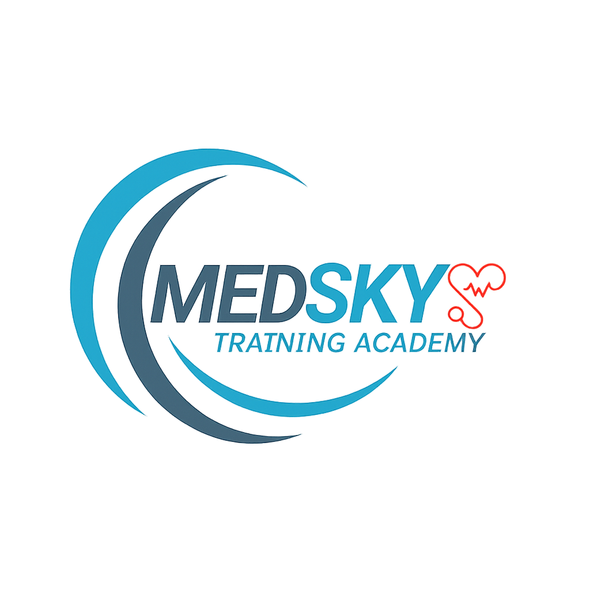
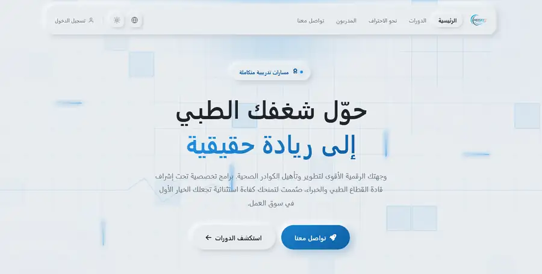

<div align="center">



# MedSky Academy

### A digital learning platform for medical translation training

[](https://medskyacademy.com)
[](https://nodejs.org/)
[](https://expressjs.com/)


</div>

## Overview

**MedSky Academy** is an online training platform focused on medical translation education. The website presents training programs and diploma paths for **editorial** and **instant/interpreting medical translation**, with a dedicated experience for discovering courses and accessing learner accounts.

The project combines a responsive front end with a Node.js and Express backend.

## Screenshots

A preview of the MedSky Academy homepage.



## Platform

| Area | Description |
| --- | --- |
| Home page | Academy introduction, programs, trainers and course discovery |
| Training programs | Dedicated pages for the Editorial Diploma and Instant Diploma |
| Learner accounts | Sign-in and account experience |
| Authentication API | Server-side authentication and session handling |
| Privacy | Dedicated privacy information page |

## Technology Stack

- **Frontend:** HTML5, CSS3, JavaScript
- **Backend:** Node.js, Express 5
- **Database:** SQLite
- **Authentication:** Server-side sessions
- **Email:** Nodemailer (optional SMTP configuration)
- **Additional integrations:** Google Identity Services

## Project Structure

```text
medsky-academy/
├── courses/                 # Diploma detail pages
├── css/                     # Page styles
├── images/                  # Brand and platform imagery
├── javascript/              # Frontend interactions
├── server/
│   ├── routes/              # Authentication and user routes
│   ├── test/                # API tests
│   ├── config.js            # Server configuration
│   ├── db.js                # SQLite database
│   ├── index.js             # Express application
│   ├── mailer.js             # Email integration
│   ├── security.js           # Security utilities
│   └── session.js            # Session handling
├── account.html
├── auth.html
├── courses.html
├── index.html
├── privacy.html
├── package.json
└── README.md
```

## Getting Started

### Requirements

- Node.js **22.13.0 or newer**
- npm

### 1. Clone the repository

```bash
git clone https://github.com/abdelmoneimayyash-cs/medsky-academy.git
cd medsky-academy
```

### 2. Install dependencies

```bash
npm install
```

### 3. Configure environment

Review `server/config.js` and configure deployment-specific values through environment variables where supported. Keep credentials, SMTP passwords, private keys and production secrets out of source control.

### 4. Run the development server

```bash
npm run dev
```

The application starts on **http://localhost:3000** by default.

For production:

```bash
npm start
```

## Available Scripts

| Command | Purpose |
| --- | --- |
| `npm run dev` | Start the server with Node.js watch mode |
| `npm start` | Start the production server |
| `npm test` | Run the Node.js test suite |

## Live Project

Visit **[medskyacademy.com](https://medskyacademy.com)** to explore the deployed platform.

## Security Notes

- Never commit `.env` files, database files, credentials or private keys.
- Use HTTPS in production.
- Configure secure cookies and production session settings for the deployment environment.
- Rotate any credential that has ever been committed publicly.

---

<div align="center">

**MedSky Academy** · Medical education, built for the web.

</div>
